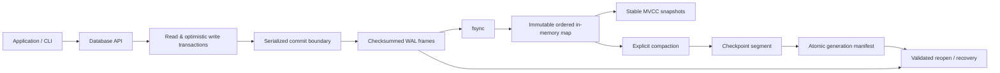

# BastionKV

BastionKV is a small, auditable embedded key-value engine written in Rust. It provides synchronous atomic commits, immutable MVCC snapshots, binary keys and values, checksummed recovery, explicit compaction, and a command-line inspection tool.

The declared durability target is **Linux on local filesystems** with working `fsync`, same-directory atomic rename, and advisory file locking. BastionKV deliberately favors inspectable storage and recovery protocols over maximum throughput or large-database scale. Read [the documented limitations](docs/limitations.md) before adopting it.

## Architecture



The engine keeps its live ordered index in a `BTreeMap<Vec<u8>, Vec<u8>>` published as an immutable `Arc` after a successful commit. The WAL contains complete transaction frames. Compaction writes a live-state checkpoint segment and rotates the WAL through an atomic, checksummed generation manifest. Reads operate on immutable maps rather than disk pages.

See [architecture](docs/architecture.md), [storage format](docs/storage-format.md), [transaction model](docs/transaction-model.md), [durability model](docs/durability-model.md), [recovery](docs/recovery.md), and [compaction](docs/compaction.md) for the precise protocol.

## Core capabilities

- Binary, non-empty keys and binary values, including empty values.
- Ordered range scans with inclusive lower and exclusive upper bounds.
- Synchronous single-key writes and atomic multi-key write transactions.
- Stable process-local point/range snapshots through later writes and compaction.
- Optimistic global-version conflict detection for write transactions.
- Checksummed/versioned WAL, checkpoint, and manifest formats.
- Recovery that tolerates incomplete WAL tails and refuses complete corrupt frames.
- Explicit compaction with crash-tested generation publication.
- Advisory process locking for writable handles and shared locking for offline verification.
- CLI commands for initialization, mutation, reads, scans, statistics, integrity verification, WAL inspection, segment inspection, and compaction.
- Deterministic fault-injection, crash, corruption, reference-model, concurrency, and benchmark tooling.

## Consistency and durability

Successful non-empty commits advance one global sequence. Any intervening commit causes an optimistic write transaction to conflict, including disjoint-key writes. Empty commits validate their base version but do not append a WAL frame or advance the sequence.

A commit is acknowledged only after the WAL data has been synchronized and the immutable map has been published under the serialization mutex. If a possibly state-changing I/O operation fails, the handle is poisoned because the externally visible outcome may be uncertain; close and reopen the database before deciding whether to retry. BastionKV does not provide transaction-level idempotency tokens.

The durability claim is intentionally narrow: process-crash behavior and Linux filesystem protocol assumptions are tested; physical power-loss behavior, controller caches, non-Linux filesystems, and hostile directory-owner races are not certified.

## Storage model

A database consists of format-owned metadata, a generation WAL, and—after compaction—a checkpoint segment. Recovery validates framing, checksums, sequence continuity, bounds, and generation metadata before rebuilding the in-memory ordered map. Incomplete final WAL frames can be truncated during writable open; complete malformed or corrupt frames fail closed.

The default logical state budget is 32 MiB and the implementation clones the full ordered map for each published version. That design keeps behavior straightforward and auditable, but it is not intended for large datasets.

## Library usage

```rust,no_run
use bastionkv::{Config, Database, Result};

fn main() -> Result<()> {
    let db = Database::create("example.db", Config::default())?;

    let mut tx = db.begin_write()?;
    tx.put(b"a", b"one")?;
    tx.put(b"b", b"two")?;
    tx.commit()?;

    let snapshot = db.begin_read()?;
    db.put(b"a", b"new")?;
    assert_eq!(snapshot.get(b"a")?, Some(b"one".to_vec()));

    db.compact()?;
    assert_eq!(snapshot.scan(None, None)?.len(), 2);
    Ok(())
}
```

`Database::open(path)` requires an existing valid database. The public API includes `get`, `put`, `delete`, `contains_key`, `scan`, `begin_read`, `begin_write`, `flush`, `compact`, `statistics`, and typed configuration.

## CLI

```sh
cargo build --release

./target/release/bastionkv init /tmp/bastion-cli
./target/release/bastionkv put /tmp/bastion-cli hello world
./target/release/bastionkv get /tmp/bastion-cli hello
./target/release/bastionkv scan /tmp/bastion-cli he
./target/release/bastionkv put /tmp/bastion-cli 00ff 0102 --hex
./target/release/bastionkv stats /tmp/bastion-cli
./target/release/bastionkv verify /tmp/bastion-cli
./target/release/bastionkv dump-wal /tmp/bastion-cli
./target/release/bastionkv compact /tmp/bastion-cli
./target/release/bastionkv delete /tmp/bastion-cli hello
```

CLI input is UTF-8 command-line bytes unless `--hex` is selected; returned keys and values are hexadecimal. `verify` and `dump-wal` are read-only inspection operations and never repair files. `dump-segment <file>` inspects a checkpoint segment directly.

## Development and verification

Requirements: Linux, Rust 1.89+, and Python 3. There are no third-party Rust crate dependencies.

```sh
bash scripts/check.sh
cargo run --example transactions -- /tmp/bastion-example
python3 scripts/bench.py --n 1000 --runs 3
cargo test --all-features --test reference stress_reference_oracle -- --ignored
```

`scripts/check.sh` runs formatting, Clippy with warnings denied, default and feature-enabled tests, rustdoc warnings, release/debug builds, the Linux OS-fault harness, and Cargo package verification. CI runs the same gate on Rust 1.89.0 and stable. Fault hooks exist only behind the explicit `fault-injection` feature and must not be enabled in production builds.

See [development](docs/development.md) and [testing](docs/testing.md) for the repository workflow and verification matrix.

## Evidence and security

The repository retains reproducible benchmark data, verification logs, an integrity hash manifest, and an adversarial repair record under [`evidence/`](evidence/). [`evidence/manifest.json`](evidence/manifest.json) maps the current correctness contract to implementation and test evidence. [`docs/threat-model.md`](docs/threat-model.md) defines trust boundaries and non-goals.

These artifacts document observed behavior; they are not a production certification or a performance-superiority claim.

## Limitations

BastionKV currently uses a bounded in-memory map, full-map cloning per published version, global write conflicts, synchronous-only commits, explicit blocking compaction, and process-local snapshots. It does not provide a server protocol, authentication layer, replication, distributed consensus, persistent snapshots, automatic corrupt-data salvage, or cross-platform durability guarantees.

For the complete list, see [docs/limitations.md](docs/limitations.md).

## License

BastionKV is proprietary software. See [LICENSE](LICENSE). Publication of the source code does not grant use, modification, distribution, or sublicensing rights.
