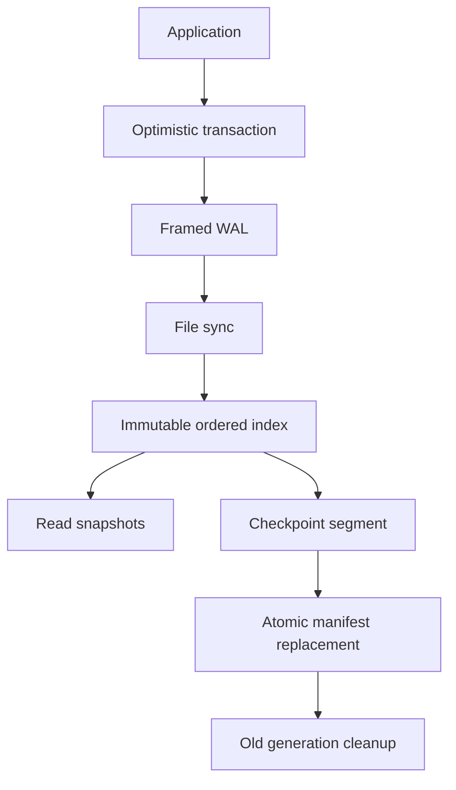

# Architecture

The ordered index is a `BTreeMap<Vec<u8>, Vec<u8>>`, published as an immutable `Arc` per commit. The WAL stores full transaction frames. A single immutable checkpoint segment stores the live map at its checkpoint sequence. Every newer WAL sequence is applied in exact consecutive order. Reads operate on maps rather than performing disk lookups. This deliberately trades clone cost and RAM for a small auditable implementation; no pretend LSM or page cache is present.

`config/error` are independent leaf modules; `codec` implements explicit bytes/validation; `disk` implements locking/streams/manifest/compaction; `lib` owns the publication mutex and public API. `disk` does not depend on engine state. CLI, example, tests, and benchmarks use real public methods.

## Locks and lifetimes

Exactly one mutex owns writable state (disk descriptor, map, sequence, poisoning and counters). No nested engine locks, callbacks, or user code under this mutex. Snapshot registration takes the mutex and increments a capped atomic lifetime count; that count doesn't publish or protect database data. Registration gets the map+sequence under the same lock as publication. Commit, compaction, flush and stats may block behind file I/O. Once registered, point/scan reads take no engine locks. Readers and write transactions hold the inner Arc and keep the process file lock alive even if Database clones are dropped. Snapshot Drop only decrements registration.

One OS advisory exclusive LOCK prevents independent writable opens. Offline verification uses a shared lock on the already existing file. Locks release on last descriptor/process exit; no stale PID marker is used. POSIX fork can inherit a lock until exec/close, so don't fork long-lived children while a handle is open. Noncooperating processes can modify files despite advisory locks and are outside the supported concurrency model.

Memory GC is Arc lifetime reclamation of process-local map versions. Compaction doesn't wait for snapshots: immutable maps already contain their values. At most 128 read/write snapshots plus current/staged/prepared maps. No crash-persistent snapshot handles. File GC follows durable manifest publication and never acts on arbitrary non-format names.

Statistics maintain current logical bytes, sequence, counts and active snapshots. Directory enumeration obtains data-file sizes, not per-key scans. WAL bytes are a reclaimable checkpoint estimate, not net space savings or a fragmentation oracle. Tombstones count delete records since open/compaction; it is not the count of distinct currently deleted keys. Counters explicitly reset on reopen.
