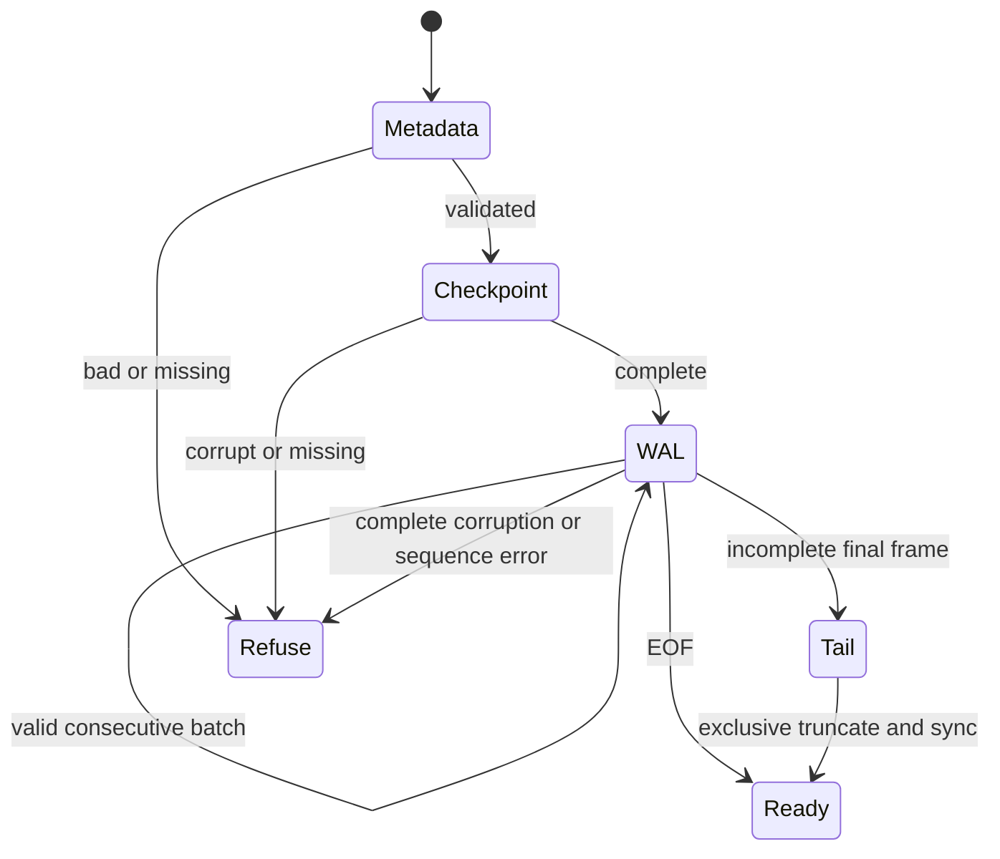

# Recovery state machine

Acquire exclusive existing LOCK → validate fixed-size MANIFEST/version/limits → derive generation filenames → validate single complete segment with exact checkpoint sequence → build live map → read WAL frames sequentially → enforce consecutive sequences/apply whole batches → detect optional incomplete final tail → truncate+sync tail → seek WAL end → cleanup owned orphan names → ready.

Recovery never salvages past complete-frame damage. Verify follows the same parser/reconstruction without truncation/cleanup and with a shared existing lock; it reports incomplete tail bytes and all unreferenced directory names. Orphans are warnings because interrupted compaction legitimately creates them. Missing referenced files are errors. No file content is trusted because its checksum alone is valid: type, marker, bounds, sorting, sequence and configuration are also checked. Integrity errors include file/frame offset/reason where practical; missing-file I/O errors include the operation/path.

Reopen is idempotent: already recovered byte files/state don't change on another recovery. Garbage collection only deletes 20-digit owned generation names or MANIFEST.tmp. Arbitrary unrelated files are reported and preserved. An init crash before initial manifest publication is never acknowledged as a database; retry refuses a nonempty incomplete directory. Inspect/remove or quarantine that new directory explicitly before reinitialization. Automatic destructive salvage/repair is not provided.
